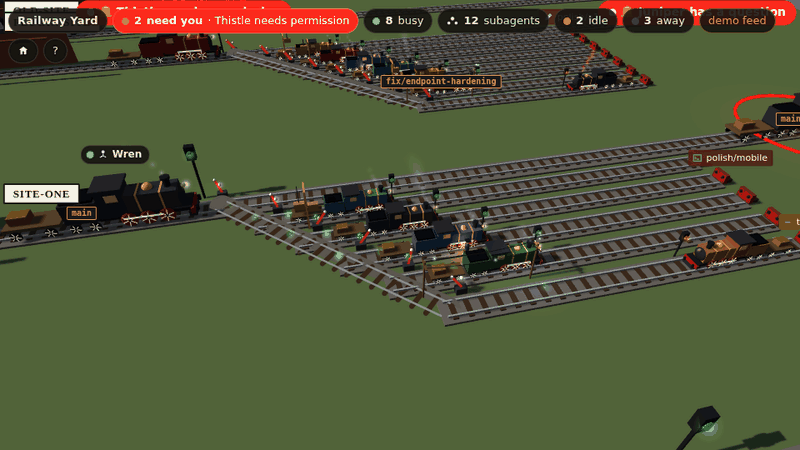
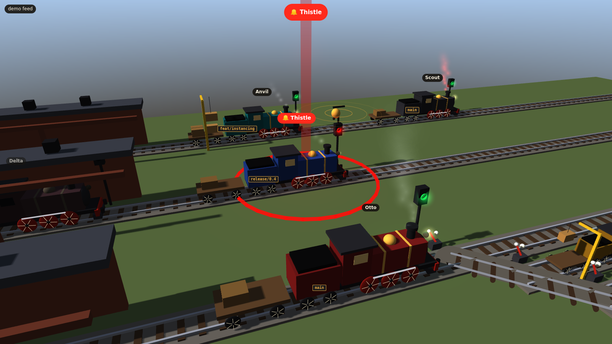
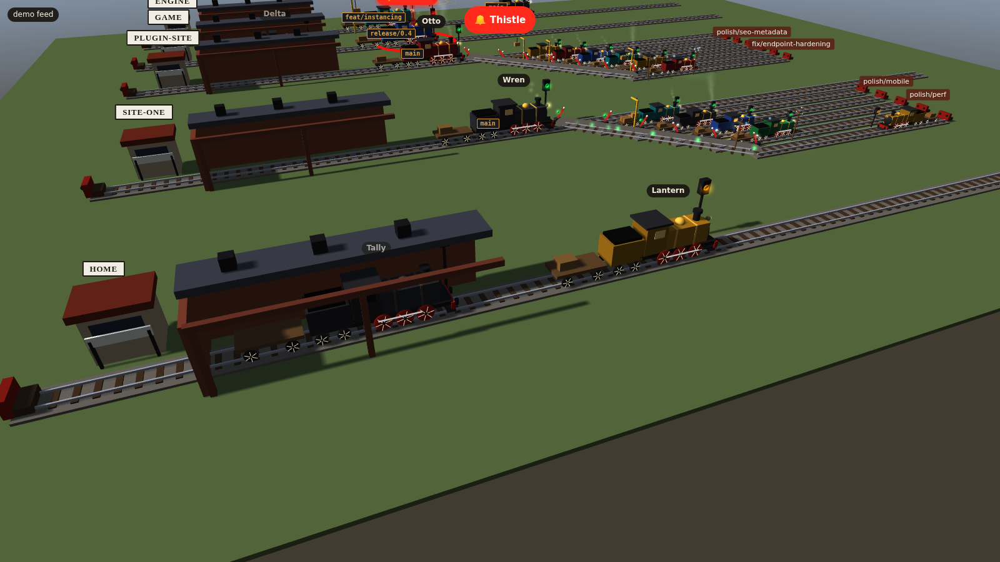
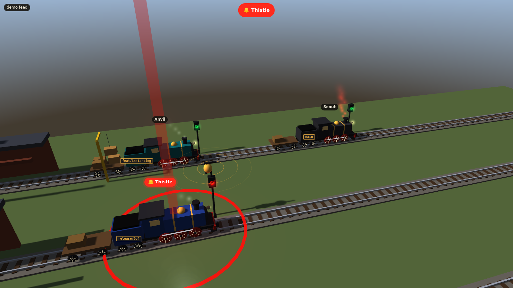
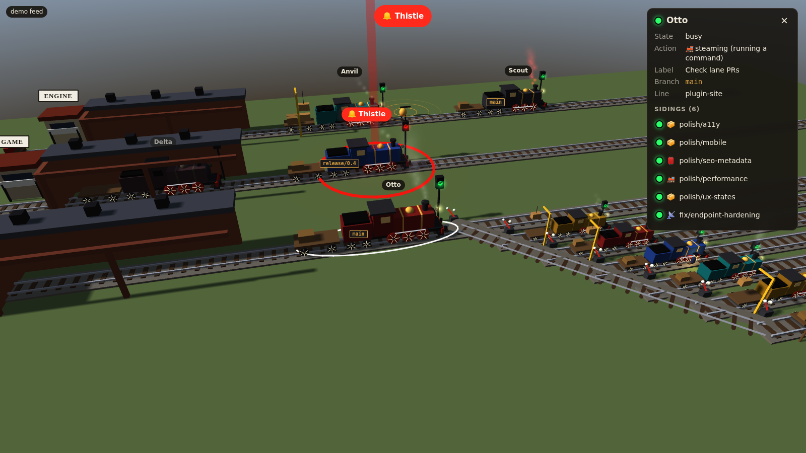
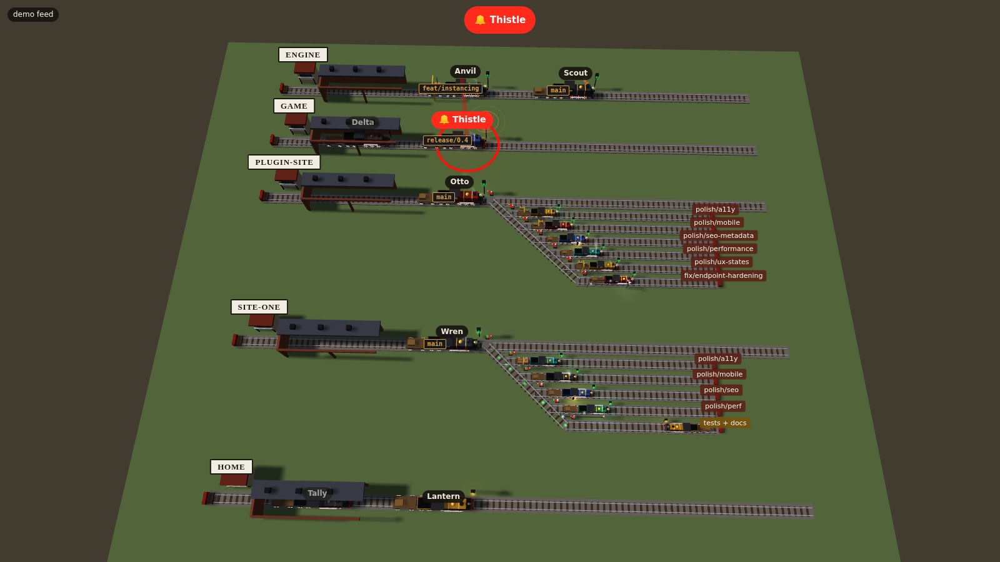

# agentviz-railway

Claude Code sessions and their subagents as a railway yard, drawn with
[Strata](https://github.com/Preponderous-Software/strata). One of the
[agentviz](https://github.com/dmccoystephenson/agentviz) family: every
visualization reads the same local feed (`/api/agents`).


*The whole yard from the demo feed. Each trunk line is a place (repo), labelled on its station board. Wren and Otto
have fanned out into sidings; Thistle, flashing red with the bell ringing and a red beam over it, is waiting on you
(also pinned to the top of the page).*


*Five seconds of Wren's yard: crates loading, smoke, the inspector's lantern, telegraph sparks, the switches throwing
and pulses running out along the ladder. Mid-clip one subagent finishes and rolls to the end of its siding.*

## How to read it

| Visual | Means |
|---|---|
| Trunk line with a station board and engine shed | a **place** (the working directory's repo) |
| Big locomotive on the trunk, name above | a **session**; its git `branch` is the brass plate on the tender |
| Small locomotives on sidings off a yard ladder just ahead of a lead, lane name at the buffer stop | that lead's **subagents** (followers) |
| Signal **green** | busy |
| Signal **amber** | idle (or a resting subagent) |
| Signal **flashing red**, bell swinging and ringing, red beam and ring, red pill at the top of the page | **waiting on the owner**: go and answer it |
| Signal **dark**, engine cold and grey, parked inside the shed | offline |
| Freight crates craned onto the wagon | `edit` |
| Dark smoke, wheels and rods turning | `run` |
| Inspector walking the train with a lantern | `read` |
| Telegraph pole with sparks and pulses along the wires | `web` |
| Ground levers throwing, lamps flipping green, pulses running into the sidings | `delegate` |
| Slow white steam puffs from chimney and cylinders | `think` |
| Headlamp pulsing, whistle steam from the cab roof | `other` |
| **Red** smoke | stalled (busy but silent for over 5 minutes) |
| Small engine at the far end of its siding, facing back | a resting subagent, headed back to merge |

Tap or click a locomotive for its panel (name, state, action, label, branch,
line, sidings). Drag to orbit, pinch or wheel to zoom, two fingers or
right-drag to pan. On a phone the panel is a bottom sheet.

## Close-ups


*A lead with its subagents: Otto steams on the trunk (running a command) while six lanes work their own sidings off the
ladder: crates (edit), lanterns (read), smoke (run), a telegraph (web).*


*Waiting on the owner: Thistle's signal flashes red, the bell swings with rings going out, and a red beam and ground
ring mark the train from anywhere in the yard.*


*Idle and offline: Lantern stands with an amber signal and no smoke; Tally sits cold and grey inside the engine shed
with its signal dark.*


*Stalled and editing: Scout's chimney pours red smoke (busy but silent too long); Anvil, on `feat/instancing`, cranes
crates onto its wagon.*


*A resting subagent: "tests + docs" has rolled to the far end of its siding and turned to face the trunk, its signal
amber.*

## Panel and phone


*Desktop: Otto selected, a white ring on the ballast and the panel listing its six sidings (tap one to jump to it).*


*Phone (390 x 844, DPR 3): Thistle selected from the red pill; the bottom sheet shows the session.*

## Other angles


*From above: the yard ladders and sidings read like a track plan.*


*Low, down the lines from the station end.*

## Run

```bash
python3 -m vendor.agentfeed serve --web web --port 8843             # live sessions on this machine
python3 -m vendor.agentfeed serve --web web --port 8843 --fixture   # the demo feed
```

Open http://127.0.0.1:8843/ (or `/?fixture=1` for the demo feed against a
live server). `?fps=1` shows the kit's frame stats, `?quality=0..2` pins a
tier. The server binds to 127.0.0.1 only: the feed describes real work.

## Build

The built engine (`web/railway-engine.js` + `.wasm`) and the kit scripts are
committed, so serving needs only Python. To rebuild after editing
`scene/main.cpp` (needs emsdk 6.0.11; downloads Strata 0.10.0 into the
gitignored `.strata/`, about 25 s):

```bash
scene/build.sh
```

## Test

```bash
python3 -m unittest discover -s tests -v                                # page, assets, feed
NODE_PATH=/root/arcade-watch/node_modules node tests/smoke.cjs          # headless Chromium: draws, taps, no errors
NODE_PATH=/root/arcade-watch/node_modules node tests/screenshots.cjs    # regenerates every image above (the GIF needs Pillow)
```

Tests use port 8943. Every image here comes from the fixture feed
(`vendor/agentfeed/fixture.json`); never commit a capture of live sessions.

## Layout

| Path | What |
|---|---|
| `scene/main.cpp` | the Strata web-kit scene: track, locomotives, signals, actions |
| `web/railway.js` | polls the feed, lays out the yard, eases between snapshots, labels, panel |
| `web/index.html` | the page |
| `vendor/agentfeed/` | vendored feed server (do not edit; re-vendor from agentviz) |
