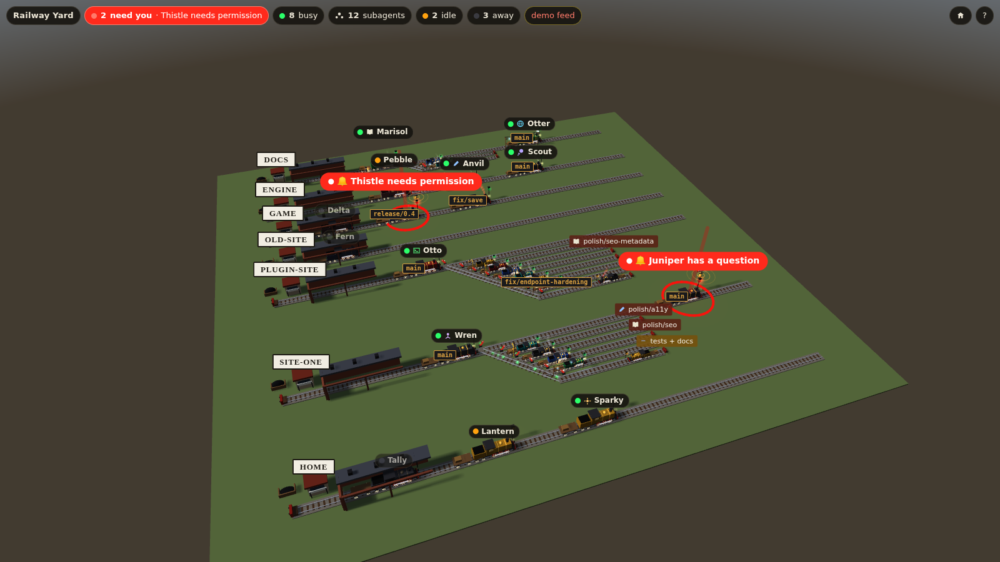
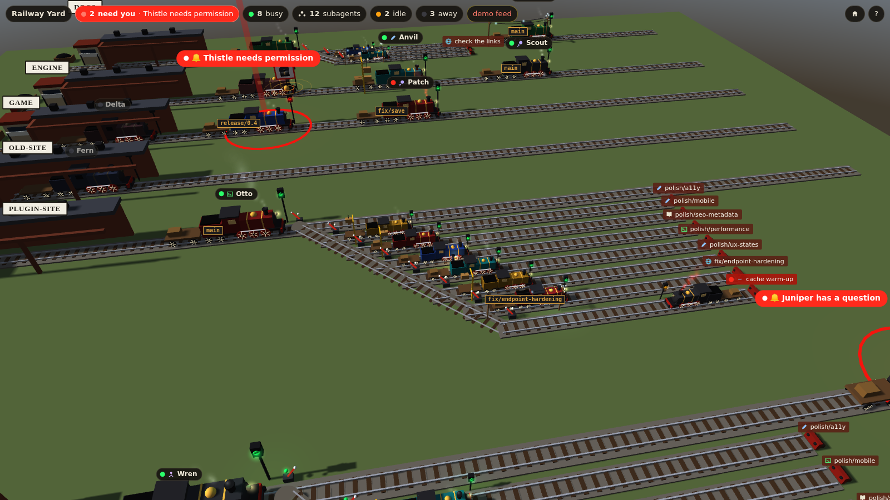
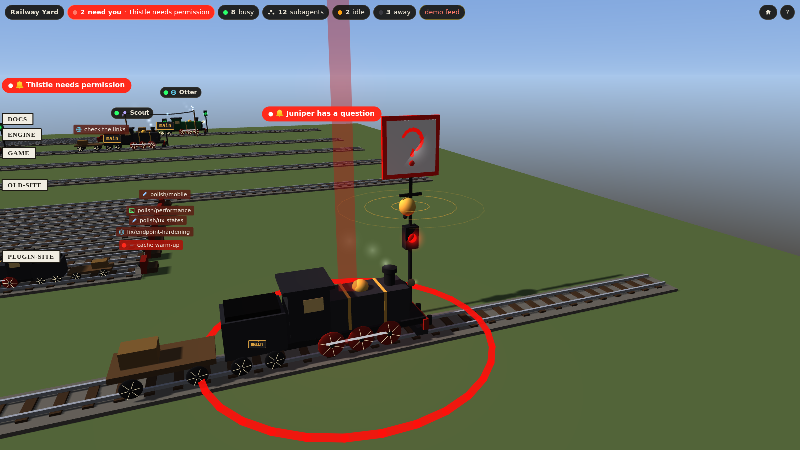
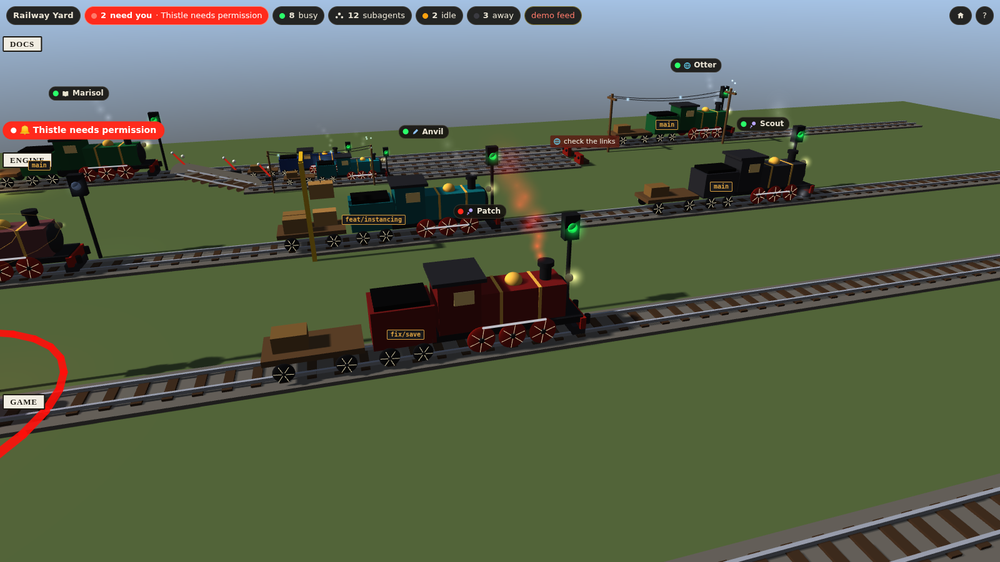
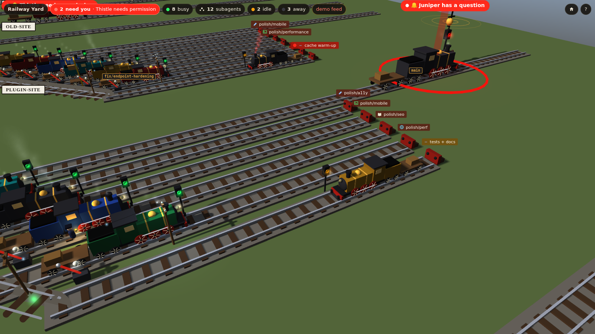
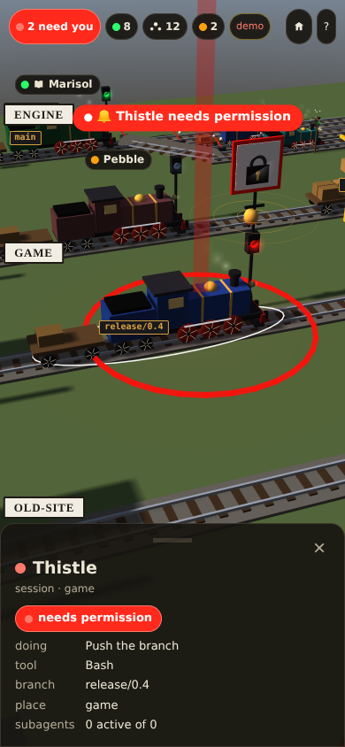
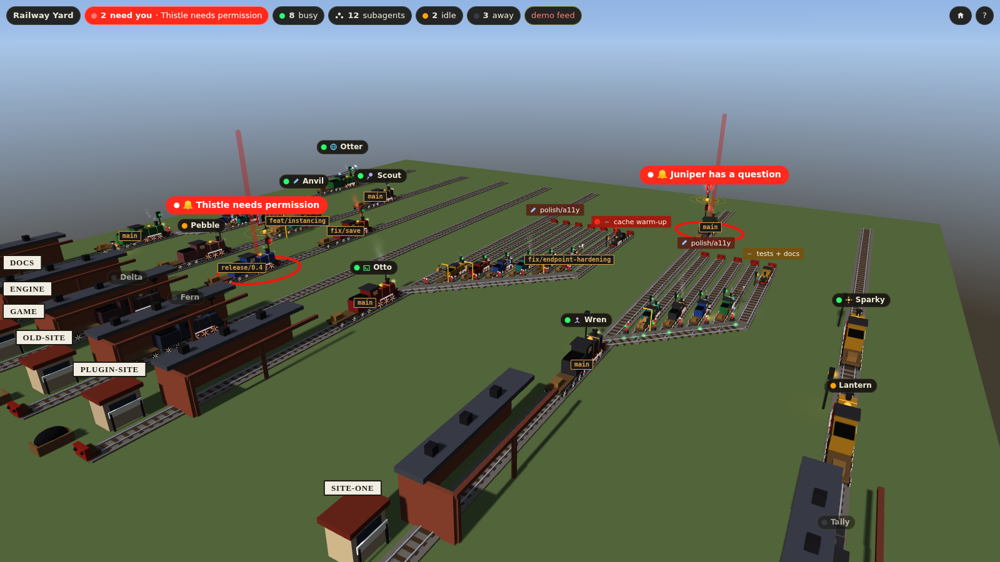

# agentviz-railway

Your Claude Code sessions and their subagents as a railway yard, drawn with
[Strata](https://github.com/Preponderous-Software/strata). Each repo is a
trunk line with its own station, each session is a locomotive on it, and its
subagents are smaller engines working sidings off a yard ladder just ahead of
it. When a session needs you, its signal flashes red, its bell rings and a
red beam stands over it, with a board that says whether it asked a question
or wants a permission.

One of the [agentviz](https://github.com/dmccoystephenson/agentviz) family:
ten views of the same feed.


*The whole yard (demo feed). Seven trunk lines, one per repo, each with its station board, shed and coal stage.
Wren and Otto have fanned out into five and seven sidings; Thistle (`game`) and Juniper (`site-one`) are waiting on
you, each under a red beam, and the red chip at the top names the next one and why.*


*Five seconds of Wren's yard: levers throwing and pulses running up the ladder (delegating), crates loading, smoke,
the inspector's lantern, the telegraph. Early on `polish/a11y` finishes and rolls to the far end of its siding;
mid-clip `polish/mobile` makes a tool call and blows its whistle.*

## Run

Needs Python 3.8 or newer and nothing else:

```bash
git clone https://github.com/dmccoystephenson/agentviz-railway
cd agentviz-railway
python3 -m vendor.agentfeed serve --web web --port 8843             # your live sessions
python3 -m vendor.agentfeed serve --web web --port 8843 --fixture   # the demo feed
```

Open <http://127.0.0.1:8843/> (the server binds 127.0.0.1 only and refuses
non-local `Host` headers). Live mode reads your Claude Code session files
under `~/.claude` and shows session names, states, git branches, tool names
and short labels (a file's basename, a Bash command's own description, a web
host, a subagent's description), never file contents, commands or prompts;
see the agentviz [SECURITY.md](https://github.com/dmccoystephenson/agentviz/blob/main/SECURITY.md).
Query options: `?fixture=1` (demo feed), `?fps=1` (frame stats),
`?quality=0|1|2`.

Drag to orbit, right-drag or two fingers to pan, wheel or pinch to zoom. Tap
a locomotive for its card (a bottom sheet on a phone, and the view slides so
the train you tapped stays above it; swipe it down or tap the cross to
close). The red **need you** chip names who is waiting and why
(a question, or a permission prompt), flies the camera to that train and
cycles through them; the house button recentres; **?** opens the legend. If
the feed stops answering, a banner says so and the last snapshot stays; with
no sessions at all, a hint says how to start.

## How to read it

| You see | It means | Close-up |
|---|---|---|
| Trunk line with a station board and an engine shed | a **place** (the working directory's repo) | [hero](docs/media/hero.png) |
| Coal heap in a bunker by the station | the place's tool calls so far: the more calls, the bigger the heap | [idle-and-offline](docs/media/idle-and-offline.png) |
| Big locomotive on the trunk, name above, brass plate on the tender | a **session** and its git `branch` | [lead-and-sidings](docs/media/lead-and-sidings.png) |
| Small locomotives on sidings off a yard ladder just ahead of a lead, lane name at the buffer stop | that lead's **subagents**; one on its own branch carries its own brass plate | [lead-and-sidings](docs/media/lead-and-sidings.png) |
| Signal **green** | busy | |
| Signal **amber** | idle (or a resting subagent) | [idle-and-offline](docs/media/idle-and-offline.png) |
| Signal **flashing red**, bell swinging and ringing, red beam and ground ring, red label and chip | **waiting on you** | [waiting](docs/media/waiting.png) |
| A red-framed white board high over the bell, painted on both faces: a red **?** / an iron **padlock** | waiting on a question / on a permission prompt | [question](docs/media/question.png) |
| Signal dark, engine cold and grey, parked inside the shed | offline | [idle-and-offline](docs/media/idle-and-offline.png) |
| Freight crates craned onto the wagon | `edit` | [lead-and-sidings](docs/media/lead-and-sidings.png) |
| Dark smoke, wheels and rods turning | `run` | [lead-and-sidings](docs/media/lead-and-sidings.png) |
| Inspector walking the train with a lantern | `read` | |
| Telegraph poles with sparks and pulses along the wires | `web` | [lead-and-sidings](docs/media/lead-and-sidings.png) |
| Ground levers throwing, lamps flipping green, pulses running up the ladder into the sidings | `delegate` | [motion](docs/media/motion.gif) |
| Slow white steam from chimney and cylinders | `think` | |
| Headlamp pulsing, whistle steam from the cab roof | `other` | |
| A short whistle blast and a headlamp flash | a **new tool call** | [motion](docs/media/motion.gif) |
| **Red** smoke, a red lane label | **stalled**: a session busy with nothing written for 5 min, or a subagent quiet that long without finishing | [stalled](docs/media/stalled.png) |
| Small engine at the far end of its siding, facing back | a resting subagent, headed back to merge | [resting-subagent](docs/media/resting-subagent.png) |

## Screenshots

All from the fixture feed (`--fixture` / `?fixture=1`), never live sessions.


*A lead with its subagents: Otto steams on the trunk (running a command) while seven lanes work their own sidings off
the ladder: crates (edit), lanterns (read), smoke (run), a telegraph (web). `fix/endpoint-hardening` is on its own
branch and carries its own brass plate; `cache warm-up` has gone quiet without finishing, so its smoke and label are
red.*


*Waiting on you: Thistle's signal flashes red, the bell swings with rings going out, a red beam and ground ring mark
the train from anywhere in the yard, and the red-framed board high over the bell shows a big iron padlock: it wants a permission.*


*Juniper asked a question, so its board shows a red "?", readable from across the yard.*


*Idle and offline on the `~` line: Lantern stands with an amber signal and no smoke; Tally sits cold and grey inside
the engine shed with its signal dark. Each station has its coal stage beside it.*


*Stalled: Patch has been busy with nothing written for over five minutes, so its chimney pours red smoke.*


*A resting subagent: `tests + docs` has rolled to the far end of its siding and turned to face the trunk, its signal
amber.*


*Tap Otto: a white ring on the ballast and the card with state, action, what it is doing, branch, and each siding as a
chip you can tap to jump to it.*



*A phone (390 x 844, DPR 3): Thistle selected, the card as a bottom sheet saying it needs permission; the view has
slid so Thistle sits above the sheet. On a phone the top bar keeps to one line, and world labels stay out from under
it.*


*From above: the yard ladders and sidings read like a track plan.*


*Low, down the lines from the station end.*

## Build and test

```bash
python3 -m unittest discover -s tests       # serves the fixture; page, assets, feed, vendored PINs
npm ci && npx playwright install chromium   # Playwright 1.61.1, for the browser tests
pip install -r requirements-dev.txt         # Pillow, for the GIF
npm run smoke                               # headless Chromium on the demo feed; saves docs/media/screenshot.png
npm run screenshots                         # every image above (or some: npm run screenshots -- hero motion)
EMSDK=/path/to/emsdk vendor/agentviz-kit/scene/build-scene.sh scene/kit.conf   # rebuild web/railway-engine.*
```

The built engine files are committed, so serving needs only Python. Tests
use port 9104 (`RAILWAY_TEST_PORT` overrides). `vendor/agentfeed/`,
`vendor/agentviz-kit/` and `web/agentviz-*` come from
[agentviz](https://github.com/dmccoystephenson/agentviz) (`tools/vendor-kit.sh`);
do not edit them here.

## How it works

The feed client, the HUD (chips, the selected-agent card and bottom sheet,
the banner), world labels, tap picking and the page-to-engine data format are
the shared agentviz kit (docs/KIT.md in agentviz). On top of it,
`web/railway-model.js` keys everything by id, lays one trunk per place
(offline sessions in shed bays at its head, then a slot per session wide
enough for its ladder and sidings), gives each subagent a stable siding and
eases trains to new positions; a resting subagent rolls to the far end of its
siding and turns round. Each frame `web/railway-frame.js` packs the yard in
the agentviz wire format (trunks and yards as zones, trains as agents,
delegation pulses as links); `scene/main.cpp` decodes it with `agentviz.h`
and draws it with Strata's primitives, lines, points and point lights
(`track.h`, `props.h`, `loco.h`, `signal.h`, `effects.h`).

## Licence

Code: [MIT](LICENSE). Screenshots and GIFs in `docs/media/`:
[CC0 1.0](LICENSE-media). The committed engine bundles Strata (MIT) and its
libraries, and the Emscripten runtime: see
[THIRD_PARTY_NOTICES.md](THIRD_PARTY_NOTICES.md).
